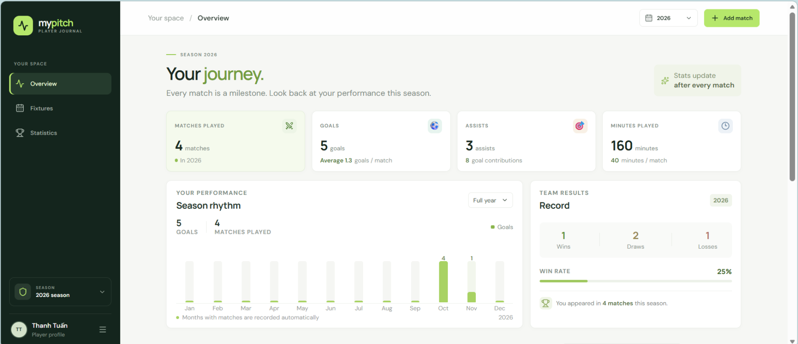
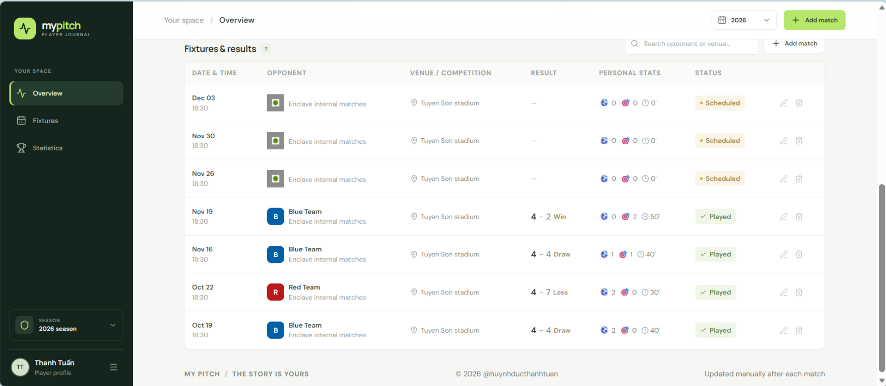

# MyPitch — Player Journal

MyPitch is a personal football journal that helps players keep their season in one place. Record upcoming fixtures, add results after a match, and follow your goals, assists, and playing time as the season unfolds.

The website brings match history and performance statistics together in a clear dashboard, with a month-by-month view for looking back at progress throughout the year.

## Website Preview

### Season Dashboard

The dashboard highlights matches played, goals, assists, minutes, and the team's win-draw-loss record. Its chart makes it easy to compare goal totals across the season.

### Match Journal

The match journal keeps fixtures and results in one searchable list. Each match includes its date, opponent, venue, score, personal stats, and status.

## What You Can Track

- Upcoming and completed matches, including kickoff time, venue, and competition.
- Match scores and outcomes from your team's perspective.
- Goals, assists, and minutes played for each completed match.
- Yearly summaries and monthly goal trends.
- Searchable match history, with a details view for each fixture.
